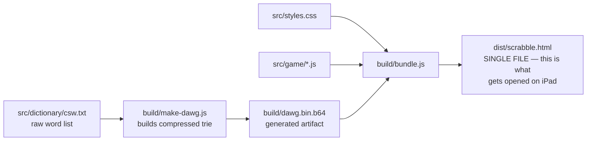
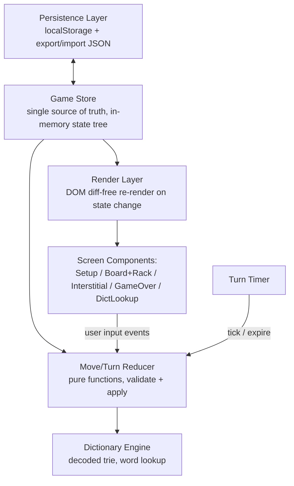
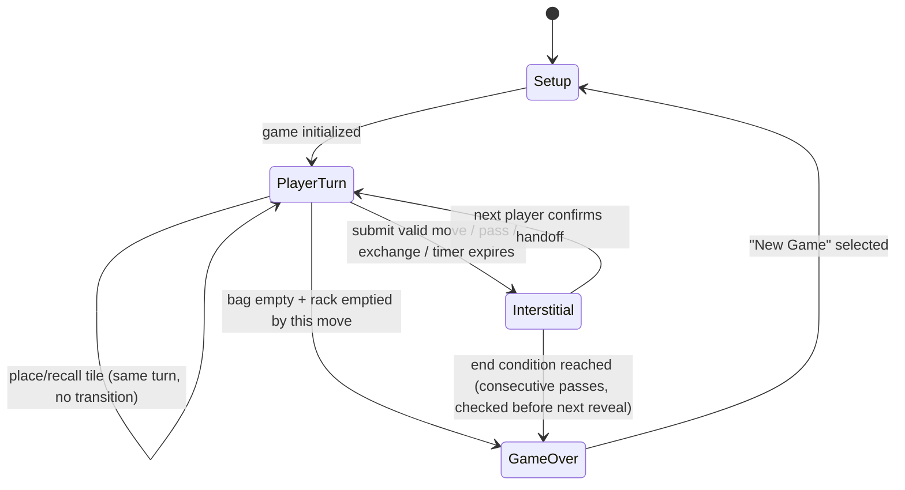

# Design Document

## Overview

This document describes the technical design for a single-file HTML Scrabble game for two players, played pass-and-play style on a shared iOS device, rendered inside a generic local HTML viewer app (e.g., "HTML Viewer Q"). **The primary target device is iPad** — this shapes layout, touch-target sizing, and the board navigation strategy described below.

Two important platform constraints drive much of this design:

1. **Unknown/limited persistence guarantees.** Lightweight local-HTML viewer apps wrap a WebView, and some do not guarantee a stable, persistent storage origin across file re-imports, app updates, or even app restarts (some reset the WebView's storage container when the file is re-opened via "Files" import). We cannot verify the specific persistence behavior of the viewer app in advance, so the design treats `localStorage` as a **best-effort cache**, not a guaranteed store, and adds an explicit manual export/import (JSON) fallback so a game is never unrecoverable.
2. **No network, no bundler at runtime.** Everything the browser loads must already be inside the one `.html` file. This pushes word-list compression and any "build tooling" to a **build-time step** that produces the final shippable artifact — there is no runtime npm/webpack. The repo will contain source files for maintainability; a small Node build script concatenates/encodes them into the single distributable HTML file.

## Architecture

### Two-stage structure: source project → single-file build

To keep the game maintainable (vs. hand-editing one giant HTML file), the implementation is split at **development time** into normal source files, and a **build script** inlines everything into the final artifact.



- `src/game/*.js` — plain ES modules, no framework, organized by concern (see Component Design).
- `build/make-dawg.js` — one-time (or CI) step: reads the CSW word list, builds a compact trie (DAWG-style, see Dictionary Design), serializes it, base64-encodes it.
- `build/bundle.js` — concatenates CSS into a `<style>` tag, JS modules into a single `<script>` tag (in dependency order, wrapped in an IIFE), and the base64 dictionary blob into a `<script id="dict-data" type="text/plain">` tag, producing `dist/scrabble.html`.
- **Only `dist/scrabble.html` is ever opened on the iPad.** The source files are for our own maintainability and are not part of the runtime.

This satisfies Requirement 1 (single-file distribution) while keeping the source code reviewable and testable.

### Runtime architecture (inside the single file)

At runtime, the file is a classic vanilla-JS single-page app with a small state machine and no external dependencies (no frameworks — keeps file size down and avoids any CDN temptation).



- **Game Store**: a single mutable JS object (`gameState`) held in memory, serializable to JSON for persistence. All mutation happens through reducer functions (`applyMove`, `applyPass`, `applyExchange`, `applyTimeout`) — never directly from UI handlers. This keeps move validation, scoring, and state transitions centrally testable and keeps the "don't mutate state on invalid move" requirement (6.6) easy to guarantee (reducers validate first, return an error object instead of a new state if invalid).
- **Render layer**: no virtual DOM library. Given the small number of screens and the fact that a full re-render of a 15×15 grid (225 cells) is cheap, the simplest and most robust approach is: on every state change, re-render the active screen's DOM from a template function. This avoids a class of "forgot to update the DOM" bugs that matter a lot for the rack-hiding security requirement (Req 2.3) — if the rack screen simply isn't rendered when it's not the active player's turn, there's no stale DOM node to accidentally leak.
- **Screens are mutually exclusive** — only one is ever mounted in the DOM at a time (others are not just `display:none`, they are not created), which directly reinforces Req 2.3 ("must not render... through scrolling, DOM inspection, etc.").

## iPad-Specific Design Considerations

Since the primary device is iPad (not iPhone), several things are easier than a phone-first design, but still need explicit handling:

| Concern | Decision |
|---|---|
| **Viewport sizes** | Design for iPad portrait (~768–834pt wide) and landscape (~1024–1194pt wide) per Apple HIG point sizes across 10.2"–12.9" models. Layout uses CSS `clamp()`/`min()` sizing, not fixed pixels. |
| **Board fit without zoom** | At iPad widths, a 15×15 board with ~40–55pt cells fits comfortably without zoom in landscape, and fits in portrait with a slightly smaller cell size. Design targets a **minimum cell size of 38pt** (just under Apple's 44pt touch target guideline, acceptable since cells are dense and adjacent, like a keyboard) and computes cell size as `min(availableWidth, availableHeight * 0.8) / 15`. |
| **Zoom/pan as fallback, not default** | Because iPad usually has room, pinch-zoom/pan (Req 4.3) is implemented as a **progressive enhancement**: a CSS-transform based pan/zoom wrapper (`touch-action: none` + pointer-event-based pinch handling, no external gesture library) that activates only when computed cell size would fall below the 38pt minimum (e.g., Split View/Slide Over multitasking on iPad shrinking the viewport), or on user request via a zoom +/- control always available in the toolbar. |
| **Orientation** | Both orientations supported; layout reflows via CSS Grid/media queries — board+rack stack vertically in portrait, sit side-by-side in landscape where width allows. |
| **Split View / Slide Over** | Since HTML Viewer Q runs as a regular iPad app, it can be placed in Split View, shrinking the effective viewport well below full width. The zoom fallback above specifically covers this case. |
| **Touch handling** | All interactive elements use `pointerdown`/`pointerup` (not `click` alone) with a minimum 38×38pt hit area, and CSS `touch-action: manipulation` to suppress double-tap-to-zoom interfering with tile placement. |
| **Safe areas** | `viewport-fit=cover` and `env(safe-area-inset-*)` padding, relevant for iPads with rounded corners/Face ID housing in landscape split layouts. |
| **Orientation lock** | Not enforced — the game is playable in either orientation, since locking orientation isn't reliably controllable from a plain web page anyway. |

## Components and Interfaces

### Module breakdown (source files, inlined at build time)

```
src/game/
  state.js          - GameState shape, initial state factory, serialize/deserialize
  persistence.js     - save/load/export/import, versioned schema, quota-safety
  bag.js              - tile distribution, shuffle (seeded PRNG for reproducible debug), draw/return
  board.js            - 15x15 premium-square layout constant, coordinate helpers
  dictionary.js       - decode base64 trie blob at startup, word lookup + prefix check API
  moveValidation.js   - connectivity, linearity, word extraction, dictionary checks (pure functions)
  scoring.js          - letter values, multiplier application, bingo bonus, end-game adjustment
  turnReducer.js      - applyMove / applyPass / applyExchange / applyTimeout -> new state or {error}
  timer.js            - countdown controller, emits onExpire -> turnReducer.applyTimeout
  render/
    setupScreen.js
    boardRackScreen.js
    interstitialScreen.js
    gameOverScreen.js
    dictLookupModal.js
    components/tile.js, components/boardCell.js, components/rack.js
  main.js             - boot: load state (or show setup), wire reducer <-> render, mount active screen
```

Each file is a plain module using an IIFE-safe pattern (no ES `import`/`export` at runtime — the build script concatenates them in dependency order and exposes an internal namespace object, e.g. `Scrabble.Dictionary.lookup(word)`), because `type="module"` in a `file://`-opened single HTML file has known loading restrictions in some WebViews; concatenation avoids that risk entirely.

### Key interfaces (shapes, illustrative)

```js
// GameState (the single source of truth, persisted as JSON)
{
  version: 1,
  players: [
    { name: "Player 1", score: 0, rack: ["A","T","E","R",...], consecutivePasses: 0 },
    { name: "Player 2", score: 0, rack: [...], consecutivePasses: 0 }
  ],
  activePlayerIndex: 0,
  board: [ [null, null, {letter:"C", isBlank:false, owner:0}, ...], ... ], // 15x15
  bag: ["A","B","Q",...],              // remaining undrawn tiles
  pendingPlacements: [ {row, col, letter, fromRackIndex, isBlank} ], // uncommitted this turn
  turnPhase: "AWAITING_HANDOFF_CONFIRM" | "PLAYER_TURN" | "GAME_OVER",
  timerConfig: { enabled: true, durationSec: 90 },
  timerRemainingSec: 90,               // only meaningful mid-turn
  moveHistory: [ { playerIndex, words:[...], score, tilesUsed, timestamp } ],
  gameOverReason: null | "BAG_EMPTY_RACK_EMPTIED" | "CONSECUTIVE_PASSES"
}
```

```js
// moveValidation.validateMove(gameState, pendingPlacements) -> 
//   { valid: true, words: [{word, score, cells}], totalScore } 
//   | { valid: false, reason: "DISCONNECTED" | "NOT_LINEAR" | "INVALID_WORD" | "NOT_IN_RACK" | "CENTER_REQUIRED", invalidWords?: [...] }
```

```js
// dictionary.isValidWord(word: string) -> boolean   // O(word length) trie walk
// dictionary.wordExists / dictionary.checkWord(word) -> boolean   // exposed to the dictionary lookup tool
```

## Data Models

### Board & premium squares

A static 15×15 constant (`BOARD_LAYOUT`), values `'TW' | 'DW' | 'TL' | 'DL' | 'STAR' | null`, matching the standard Scrabble layout (triple word on corners/edges, double word on diagonals, center star as double word). Encoded once as a literal array of 15 strings (e.g., `"3..2...3...2..3"` row-encoding where digits/letters map to square types) to keep source compact — expanded to the full type grid at startup.

### Tile distribution & values (standard English set, 100 tiles)

| Letter | Count | Value | Letter | Count | Value |
|---|---|---|---|---|---|
| A | 9 | 1 | N | 6 | 1 |
| B | 2 | 3 | O | 8 | 1 |
| C | 2 | 3 | P | 2 | 3 |
| D | 4 | 2 | Q | 1 | 10 |
| E | 12 | 1 | R | 6 | 1 |
| F | 2 | 4 | S | 4 | 1 |
| G | 3 | 2 | T | 6 | 1 |
| H | 2 | 4 | U | 4 | 1 |
| I | 9 | 1 | V | 2 | 4 |
| J | 1 | 8 | W | 2 | 4 |
| K | 1 | 5 | X | 1 | 8 |
| L | 4 | 1 | Y | 2 | 4 |
| M | 2 | 3 | Z | 1 | 10 |
| Blank | 2 | 0 | | | |

Stored as a constant table consumed by `bag.js` (to build the initial bag) and `scoring.js` (to look up point values).

## Dictionary Design (Requirement 7)

### Why a trie/DAWG instead of a flat word list

Collins Scrabble Words (CSW) is ~280,000+ entries. A flat JSON array of words, even newline-joined, would be several MB of mostly-repeated prefixes/suffixes (e.g., thousands of words share "-ING", "-ED", "-TION"). A **trie** collapses shared prefixes; a **DAWG** (Directed Acyclic Word Graph) additionally collapses shared *suffixes* by merging identical sub-trees, which is dramatically smaller for large natural-language-like word lists. This directly satisfies Req 7.1's call for "trie or delta-encoded" embedding.

### Build-time generation

`build/make-dawg.js` (Node, run once per CSW release, not at game runtime):

1. Read the raw CSW word list (one word per line, uppercase, A–Z only).
2. Build a trie, then minimize it into a DAWG by merging equivalent suffix subtrees (standard incremental DAWG construction: insert words in sorted order, maintain a register of previously-seen equivalent states to merge).
3. Serialize the DAWG as a flat array of nodes, where each node is `{ letter, isWord, children: [childNodeIndices] }`, packed into a compact binary format:
   - Each node: 1 byte letter (A–Z mapped to 1–26, 0 reserved), 1 bit "is end of word", variable-length child index list (delta + varint encoded since indices cluster).
   - Resulting byte buffer is base64-encoded for safe embedding inside a `<script type="text/plain">` tag (avoids `</script>` collision issues that raw binary-as-string could hit).
4. Output `build/dawg.bin.b64`, consumed by `build/bundle.js` during the final HTML assembly.

Expected size: DAWGs for large English word lists of this size typically land in the low hundreds of KB to ~1–2MB packed (exact figure depends on CSW edition and final encoding efficiency) — this will be measured against the file-size budget (see Risks) once the real word list is sourced, and the encoding tuned (e.g., adding a lightweight bit-packing pass) if it runs large.

### Runtime decoding & lookup

- On startup, `dictionary.js` reads the base64 blob from the embedded `<script>` tag once, decodes it to a `Uint8Array`, and parses it into an in-memory node array (no re-parsing per lookup).
- `isValidWord(word)`: walk the DAWG letter by letter from the root; O(word length), no scanning.
- `checkWord` (for the standalone lookup tool, Req 7.3) reuses the same function — the UI just surfaces a text input + the boolean result, so no separate dictionary structure is needed for that feature.

### Sourcing the word list

The actual CSW word list text file is **not yet included in this repo** — Requirement 7 commits to using Collins Scrabble Words for validation correctness, so `src/dictionary/csw.txt` needs to be sourced from a licensed/legitimate source before the build step can run. This is called out explicitly as a build prerequisite (see Risks).

## Turn & Screen State Machine (Requirements 2, 9)



Key rule enforced in the reducer: **the transition into `PlayerTurn` (rack becoming visible) only happens as a direct result of the handoff-confirm tap**, never automatically after a move. This is the concrete mechanism behind Req 2.1/2.2 — there is always a screen in between where neither rack is rendered.

### Interstitial screen contents (Req 2.4)

Shows: board snapshot (read-only, non-interactive preview), both scores, "It's [Player]'s turn — tap to reveal your rack" button. Does not show: either rack, pending tiles from the just-completed turn (those are already committed to the board by this point, or discarded if the move was invalid/timed out).

## Move Validation Algorithm (Requirement 6)

Given `pendingPlacements` (cells the current player has tentatively filled this turn) and the current `board`:

1. **Non-empty check**: if no pending placements and action is "submit", reject (nothing to play) — handled as a UI-level disabled state, not a reducer error.
2. **Center square check** (first move only): if `board` is entirely empty, require one pending placement at (7,7).
3. **Linearity check**: all pending placements must share the same row (horizontal play) or same column (vertical play). Single-tile plays are ambiguous until combined with existing board context — resolved by checking both axes for adjacency.
4. **Contiguity/connection check**: walking from the minimum to maximum row/col of the pending placements (inclusive), every cell in that span must be occupied (either by a pending placement or a pre-existing tile) — this both enforces "no gaps" and, combined with requiring at least one pre-existing neighbor for non-first moves, enforces board connectivity (Req 6.2).
5. **Word extraction**: for the primary axis, extract the full contiguous run of letters through the pending placements (extending into existing tiles on either side). For each pending placement, also extract the perpendicular run (if length > 1) as a crossing word.
6. **Dictionary validation**: every extracted word (primary + crossings) is checked via `dictionary.isValidWord`. If any fails, the whole move is rejected with the offending word(s) named in the error (Req 6.5/6.6) — no partial application.
7. **Rack ownership check**: each pending placement's source tile must still be present in the active player's in-memory rack array (defends against any state-desync bugs; also naturally true since placements are removed from the rack array the moment they're placed).
8. **Scoring** (only computed once validation passes): see Scoring below.

All of the above are pure functions taking `(board, players, pendingPlacements)` and returning either a success payload or a typed error — fully unit-testable without any DOM.

## Scoring Algorithm (Requirement 8)

1. For the primary word and each crossing word, sum letter values of **every** letter in that word (including existing board tiles that are part of it), but only apply a letter multiplier (DL/TL) for cells that were **newly placed this turn** — pre-existing tiles keep their plain value since their multiplier was already consumed when first played.
2. Apply a word multiplier (DW/TW) to the whole word's sum **only if at least one of the newly placed tiles this turn sits on that multiplier square** — again, previously-played words don't get re-multiplied.
3. Sum all word scores (primary + each crossing) for the turn's total.
4. If `pendingPlacements.length === 7` (i.e., the entire rack was used), add 50.
5. End-of-game adjustment (triggered by the reducer when a game-over condition is detected): for each player, subtract the point value of tiles remaining in their rack from their score; if the game ended specifically because a player emptied their rack, add the sum of the *other* player's remaining tile values to the emptying player's score (not simply a mirrored subtraction — this matches standard Scrabble end-game rules).

## Persistence Design (Requirement 1.4, and the viewer-app risk noted above)

Layered strategy, from most to least automatic:

1. **Primary: `localStorage`.** On every state change, debounce-save the serialized `gameState` (JSON) under a versioned key (`scrabble_save_v1`). On boot, attempt to load and parse it; validate the `version` field for forward-compatibility.
2. **Fallback detection:** if `localStorage` is unavailable, throws, or silently fails to round-trip (write-then-immediately-read-back check at boot), the game still runs fully in-memory for the session but surfaces a persistent, dismissible banner: *"Auto-save isn't available in this viewer — use Export before closing."*
3. **Manual Export/Import (always available, not just a fallback):** a toolbar action serializes `gameState` to a JSON string and presents it via a `<textarea>` + "Copy" button (and, since there's no network, this is the most reliable device-independent path — the user can paste it into Notes, iCloud, etc. and paste it back into the Import box next session). This also doubles as a way to move a game between devices, which isn't a stated requirement but costs nothing extra given the export already exists.
4. Each reducer-driven state change writes to the in-memory store synchronously and to `localStorage` asynchronously/debounced (e.g., 300ms after the last change) — so rapid tile placement during rack arrangement doesn't thrash storage writes, while a submitted move is flushed immediately (not debounced) since it's the point most worth not losing.

## Error Handling

- **Invalid move submission**: reducer returns `{valid: false, reason, ...}` without mutating state; UI renders an inline, dismissible error message near the Submit button naming the specific problem (e.g., "‘QX’ is not a valid word", "Tiles must be connected to existing tiles on the board"). Board/rack visually revert pending tiles to their rack positions only if the player chooses "Recall All" — an invalid submission does *not* auto-clear pending tiles, so the player can adjust and resubmit.
- **Corrupt/unreadable save data**: on boot, if `JSON.parse` fails or `version` is missing/unrecognized, do not crash — show the Setup screen with a non-blocking notice that a previous save couldn't be loaded, and offer the Import box in case the user wants to paste a manually-exported backup.
- **Bag underflow during exchange**: UI disables the Exchange action (grayed out with a tooltip/label) whenever `bag.length < 1`; reducer additionally guards and rejects the action defensively even if somehow invoked.
- **Dictionary blob missing/corrupt** (shouldn't happen post-build, but defensively): if decoding fails at startup, show a blocking error screen rather than silently allowing unchecked words to be accepted — word validation must fail closed, not open.

## Testing Strategy

Because all core logic (`moveValidation.js`, `scoring.js`, `bag.js`, `dictionary.js`, `turnReducer.js`) is written as pure functions operating on plain data, it is unit-testable in Node without any DOM/browser:

- **Dictionary**: round-trip tests (encode a small known word list, decode, verify lookups match); plus tests against the real built CSW DAWG for known valid/invalid words and edge cases (2-letter words, words with Q not followed by U, etc., which CSW permits more of than TWL).
- **Move validation**: table-driven tests covering first-move-must-cover-center, disconnected placements, non-linear placements, gap detection, crossing-word extraction correctness, blank-tile handling.
- **Scoring**: known worked examples (including bingo bonus, overlapping multiple multipliers, pre-existing tiles not re-scoring their multiplier).
- **Bag/distribution**: statistical sanity check (100 tiles total, correct per-letter counts) and shuffle determinism under a seeded PRNG for repeatable test runs.
- **Manual/on-device pass**: since the real unknown is the viewer app's rendering and storage behavior, a manual test pass on the actual iPad + HTML Viewer Q app is required before considering this "done" — specifically: persistence survives app backgrounding, pinch-zoom works, touch targets are comfortable, and the rack-hiding interstitial can't be bypassed by iOS multitasking (e.g., App Switcher preview). This last point is called out as a risk below.

Build-time correctness (the DAWG construction) is the highest-risk piece of logic and will get the most thorough unit test coverage before trusting it as the sole gatekeeper of word validity.

## Risks & Open Items

1. **Word list sourcing.** The actual CSW text file must be obtained from a legitimate source before the dictionary can be built; this blocks `build/make-dawg.js` from running for real until that's resolved. *(Flagging now so it's not a surprise during implementation.)*
2. **Viewer app persistence is unverified.** We don't have confirmed documentation that this specific HTML viewer app preserves `localStorage` across sessions/re-imports. The design mitigates this with the export/import fallback, but this should be smoke-tested early (write a trivial `localStorage` test page, close/reopen the app, confirm) rather than discovered late.
3. **App Switcher thumbnail leak.** iOS captures a screenshot of the WebView content for the App Switcher / multitasking preview. If a player backgrounds the app mid-turn with their rack visible, the other player could glimpse it in the task switcher. Mitigation to consider in implementation: listen for `visibilitychange`/`pagehide` and immediately swap the visible screen to the Interstitial (hiding the rack) whenever the page is hidden, restoring only after an explicit re-confirmation. Flagging as a design-level requirement add-on rather than deciding silently — see question below.
4. **Final dictionary artifact size** is an estimate until built from the real CSW list; if it lands too large for comfortable handling inside the viewer app, a secondary compression pass (e.g., bit-packing node fields tighter) is the planned mitigation, not a redesign.

---

Before moving to the implementation task breakdown, two points from the Risks section are worth a decision:

1. **App Switcher rack leak (Risk 3)** — should I add an explicit requirement/behavior that auto-hides the rack (jump to interstitial) whenever the app is backgrounded or loses visibility, so a glance at the iOS App Switcher can't reveal a rack?
2. **Persistence smoke test** — are you able to do a 2-minute manual check in HTML Viewer Q (a trivial page that writes/reads `localStorage`, background/reopen) before we build the real persistence layer, so the design doesn't bet on unverified behavior? I can produce that tiny test page right now if useful.

Let me know on those two, plus anything else you'd like adjusted in the design, and I'll finalize `design.md` (already written to `.kiro/specs/scrabble-pass-and-play/design.md`) before we move to the task breakdown.
